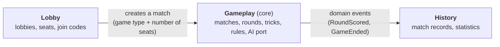
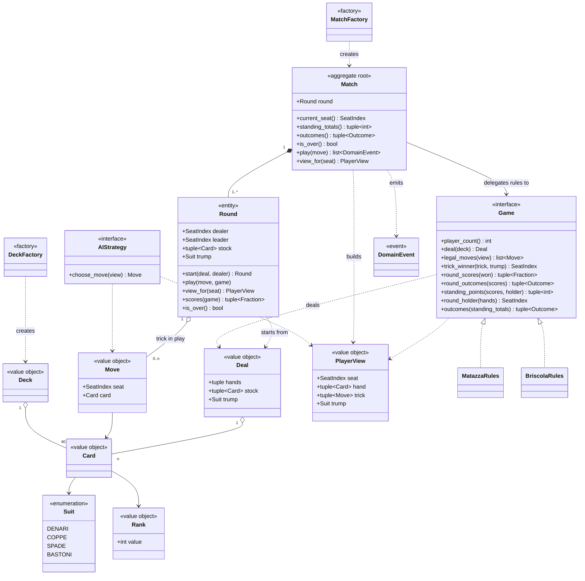
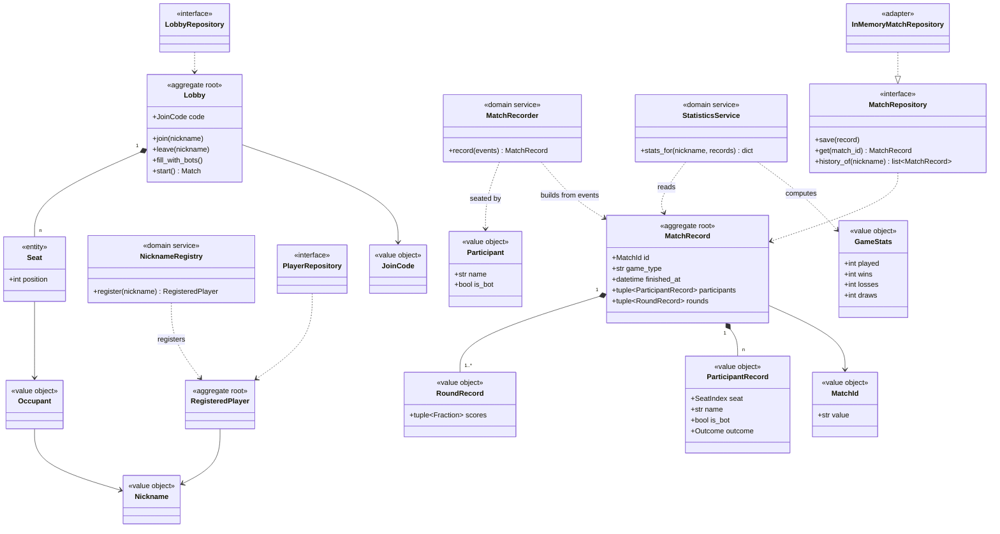

# Domain model

Domain model of **italian_card_games**: ubiquitous language, bounded contexts, DDD building blocks and class diagrams. Requirement IDs (`FR-xx`, `NFR-xx`) refer to [requirements.md](requirements.md).

## 1. Ubiquitous language

Words are used with exactly one meaning in code, tests and documents. Italian terms are kept where they are the vocabulary of the card games.

| Term | Code name | Meaning |
|---|---|---|
| Game | `Game` | A *kind* of card game with its own rules (Matazza, Briscola). |
| Match | `Match` | One play-through of a game, from the first deal until an end condition. |
| Seat | `SeatIndex` (Gameplay), `Seat` (Lobby) | A position at the table. A match has as many seats as its game requires. |
| Player | | Whoever fills a seat: a human (with a nickname) or a bot. The engine does not distinguish them. |
| Suit (seme) | `Suit` | `DENARI`, `COPPE`, `SPADE`, `BASTONI`. |
| Rank | `Rank` | A number from 1 to 10. Rank 1 is the *asso* (ace). |
| Card | `Card` | A suit and a rank. |
| Deck (mazzo) | `Deck` | The 40 distinct cards. |
| Hand | | The cards a seat holds and has not played yet. A tuple of cards inside `Round`. |
| Move | `Move` | A seat playing one card. |
| Trick (presa) | | The cards played one per seat, from a leader, until a winner takes them. The moves in play are a tuple inside `Round`. |
| Leader | | The seat that plays the first card of a trick. |
| Led suit | | The suit of the first card of a trick. |
| Deal | `Deal` | How a game splits a shuffled deck: a hand per seat, the stock and the trump suit (FR-07, FR-20). |
| Stock (mazzo) | | The cards left after the deal, drawn from the front after each trick. Empty in Matazza. |
| Trump (briscola) | | In Briscola, the suit of the last card of the stock, which is turned up. A trump beats any card of another suit. `None` in Matazza. |
| Round | `Round` | One deal of the deck, played out in tricks until all hands and the stock are empty. |
| Dealer | | The seat that deals a round. It rotates each round (FR-11). |
| Round score | | Points a seat gets from the cards it captured in one round. A `Fraction`, never a float (FR-12). |
| Standing points | | Penalty points accumulated across the rounds of a Matazza match, as an integer per seat. Reaching the limits ends the match. Briscola has none. |
| Cursed card | | In Matazza, the 8 of spades. Its holder is relevant when standing points are awarded. |
| Solo win | | In Matazza, a round in which three seats each score less than 1.0 (exactly 1.0 does not count). That seat wins the match. |
| Outcome | `Outcome` | `WIN`, `LOSS` or `DRAW` for a seat at the end of a match (FR-19). Only a Briscola match tied at 60 points each is a `DRAW`. |
| Player view | `PlayerView` | What one seat may see of the match: its own hand, the cards on the table and the trump suit (FR-06). |
| Domain event | `DomainEvent` | A fact that happened in a match (e.g. `TrickWon`). Other parts of the system react to it. |
| Lobby | `Lobby` | A waiting room where seats are filled before a match starts. |
| Join code | `JoinCode` | The code used to enter a lobby. |
| Nickname | `Nickname` | The name a human registers. It is unique and reserved. |
| Registered player | `RegisteredPlayer` | A human who has registered a nickname. Their history and statistics belong to that nickname. |
| Match record | `MatchRecord` | The persisted summary of a finished match. |
| Bot / AI strategy | `AIStrategy` | Something that chooses a move given a player view. |

"Game" is the kind of game and "match" is one play. Requirements sometimes say "game ends" to mean a match ends.

## 2. Bounded contexts

The same word means different things in different parts of the system. A player is a registered nickname in the lobby, a seat in a match, and a name with counters in the statistics. These are separate contexts, each with its own model.

| Context | Responsibility | Core? |
|---|---|---|
| **Gameplay** | Cards, matches, rounds, tricks, rules, scoring, end conditions, the `AIStrategy` port. | Yes: this is the heart of the product. |
| **Lobby** | Registering unique nicknames, creating and joining lobbies, filling seats with humans or bots, who is connected, starting a match. | Supporting |
| **History** | Persisting finished matches and computing statistics. | Supporting |

Relations between contexts:

- **Lobby uses Gameplay** through the match factory. Gameplay does not know the lobby exists.
- **History consumes Gameplay's events**. Gameplay does not know History exists.
- Contexts share only identifiers and events, never objects. Gameplay knows seats by `SeatIndex`. The mapping from seat to nickname lives in the Lobby and reaches History when the match is recorded.
- **Who produces a move is outside Gameplay.** A match only receives "seat *i* plays card *c*". Human, bot, or a bot taking over after a disconnect (FR-30) look the same to it (FR-04).

## 3. Building blocks per context

### 3.1 Gameplay

| Kind | Name | Notes |
|---|---|---|
| Value object | `Suit`, `Rank`, `Card` | Immutable. Equal when their values are equal. |
| Value object | `Deck` | Exactly 40 distinct cards (FR-02). |
| Value object | `SeatIndex` | A number from 0 to player count minus 1. |
| Value object | `Move` | A seat and a card. |
| Value object | `Deal` | The hands, the stock and the trump suit that a game makes from a shuffled deck. |
| Value object | `Outcome` | `WIN`, `LOSS` or `DRAW`. |
| Value object | `PlayerView` | Own hand, the moves on the table and the trump suit. Built by the match (FR-06). |
| Entity | `Round` | Holds the hands, the dealer, the leader, the trick in play, the cards each seat has won, the stock and the trump suit. It validates each move against the `Game`, resolves a trick when it is complete and then lets the winner draw first from the stock. The hands, the trick and the standing points are plain tuples, not entities of their own. |
| **Aggregate root** | `Match` | The only object outside code talks to. Built from a `Game` and an injected `Random`, it deals each round, plays moves through `Round`, scores the round, awards the standing points, rotates the dealer and ends the match. It enforces every rule and invariant of its rounds and tricks. It has no identity of its own: a match in play needs none, and the `MatchId` belongs to its `MatchRecord` in History. |
| Factory | `DeckFactory` | Builds a shuffled `Deck` from an injectable random source (FR-02, NFR-04). |
| Factory | `MatchFactory` | *Planned, not in code yet.* Builds a `Match` for a game type and a number of seats. The Lobby needs it, so it comes with the Lobby. |
| Port (interface) | `Game` | The rules of one game: player count, deal, legal moves, trick winner, round scores, round outcomes, standing points, round holder, end conditions (FR-01, FR-03). Implemented by `MatazzaRules` and `BriscolaRules`. |
| Port (interface) | `AIStrategy` | `choose_move(view) -> Move`. Implemented by the rule-based, LLM and (stretch) Prolog strategies (FR-21). |
| Domain event | `CardPlayed`, `TrickWon`, `RoundScored`, `StandingPointsAwarded`, `GameEnded` | Frozen dataclasses with a common `DomainEvent` base, returned as a list by `Match.play`. A round that decides the match by itself (a Matazza solo win, or any Briscola round) ends it with `GameEnded` and no `StandingPointsAwarded`. Used for real-time updates (FR-29) and for History (FR-31). |

Design choices:

- **Mutable aggregate, events as output.** `Match` and `Round` change in place, like the aggregates they are, and `Match.play` returns the list of events that the move caused. An illegal move raises `IllegalMoveError` and leaves the state unchanged. Replay is deterministic (NFR-04) because the only source of randomness is the `Random` injected into `Match`, and the same events feed WebSockets and History. A bot that wants to try a move uses `Game.legal_moves` on its `PlayerView`, so it never needs a copy of the match.
- **Per-game rules behind `Game`.** `Match` delegates every game-specific decision to its `Game`. Adding Briscola does not change `Match` (FR-01).
- **Ports are `typing.Protocol`s.** `Game` and `AIStrategy` are matched by shape, so adapters (LLM, Prolog) do not inherit from an engine class. Mypy checks the signatures (NFR-01).
- **Legal moves come from the player view.** `Game.legal_moves(view)` uses the same `PlayerView` a bot receives: the seat, its hand, the cards on the table and the trump suit. That is enough for follow-suit rules, and it guarantees a bot and the legality check see the same information (FR-04, FR-06).
- **`Game` grows with the rules.** It has `player_count`, `deal`, `legal_moves`, `trick_winner`, `round_scores`, `round_outcomes`, `standing_points`, `round_holder` and `outcomes`. `deal(deck)` returns a `Deal`. `trick_winner(trick, trump)` takes the moves of a complete trick and the trump suit, `None` for a game without one, and raises an error for a trick of the wrong size. `round_scores` takes the cards each seat won, in seat order, and returns exact `Fraction` scores; it raises an error for a wrong pile count or a duplicate card. `round_outcomes(scores)` returns the outcome of every seat if this round alone ends the match, or `None` if the match goes on (FR-12, FR-13, FR-20). `standing_points(scores, holder)` returns the points each seat earns in a round, and `round_holder(hands)` returns the seat dealt the key card (the 8 of spades in Matazza), or `None`. Whose turn it is belongs to `Match`, not to `Game.legal_moves`.
- **Matazza rules live on `MatazzaRules`, with no separate domain services.** The trick winner, round scores, solo win and standing points are plain methods of `MatazzaRules`, so there is no `TrickResolver` or `StandingsCalculator`. `round_outcomes` holds the solo win (the other three score below 1.0), which replaced a separate `solo_winner` method. `standing_points(scores, holder)` is on the `Game` port, because `Match` calls it after `round_outcomes` returns `None`. It takes the four round scores and the seat dealt the 8 of spades (the holder, which cannot be recovered from the scores). It returns the points each seat earns, always two in total, and raises an error for three low scores, a wrong score count or a holder outside the table (FR-14 to FR-17).
- **Briscola is one round and two players.** `BriscolaRules` has 2 seats and no teams, so `Game` needed no team support (FR-03). `deal` gives 3 cards to each seat in turn and keeps the other 34 as the stock; the suit of the last card of the stock is the trump. The rules are stateless: the trump travels in the `Deal`, the `Round`, the `PlayerView` and the `trick_winner` argument, so one `BriscolaRules` serves any number of rounds. Any card in hand is legal, with no duty to follow suit. A trick goes to the highest trump, else to the highest card of the led suit, with strength Ace, 3, 10, 9, 8, 7, 6, 5, 4, 2. After each trick the winner draws first, then the other seat, so the turned-up trump card goes to the last drawer. Card points are Ace 11, 3 is 10, 10 is 4, 9 is 3, 8 is 2, the rest 0, 120 in all. `round_outcomes` gives the win to the higher score, and 60 each is a `DRAW` for both seats. It never returns `None`, so `Match` ends the match after the round with `GameEnded` and no standing points.
- **Briscola implements the standing methods as neutral stubs.** `round_holder` returns `None`, `standing_points` returns zeros and `outcomes` returns `None`, because `Match` never reaches them for a game whose `round_outcomes` is always decided. This is a known trade-off of one `Game` port for both games (see section 6).

### 3.2 Lobby

| Kind | Name | Notes |
|---|---|---|
| Value object | `Nickname`, `JoinCode` | Validated on creation. |
| Value object | `Occupant` | Human (with a nickname) or bot. |
| Entity | `Seat` | Identity: its position in the lobby. Holds an occupant or is empty. |
| **Aggregate root** | `RegisteredPlayer` | Identity: its `Nickname`. Created only through the registry, so a nickname exists once (FR-26). There is no ownership check: anyone who enters a registered nickname can use it. |
| **Aggregate root** | `Lobby` | Identity: its join code. Controls joining, leaving, bot fill, and starting a match. Only registered players can join. |
| Domain service | `NicknameRegistry` | Registers a nickname, rejecting one that is already taken. Uniqueness spans all players, so it cannot live inside a single `RegisteredPlayer`. |
| Factory | `LobbyFactory` | Creates a lobby with a fresh join code from an injectable generator. |
| Repository (port) | `PlayerRepository` | Stores registered players. It must survive restarts, so the adapter is SQLite via SQLAlchemy, with a unique constraint on the nickname. |
| Repository (port) | `LobbyRepository` | Lobbies are short-lived, so an in-memory adapter is enough. |

### 3.3 History

| Kind | Name | Notes |
|---|---|---|
| Value object | `MatchId` | The identity of a recorded match. Given to the recorder from outside, so tests stay deterministic. |
| Value object | `Participant` | Who sits in a seat before the match is recorded: a name and whether it is a bot. |
| Value object | `RoundRecord` | The exact `Fraction` score of each seat in one round, by seat order (FR-31). |
| Value object | `ParticipantRecord` | Seat, name (a human's nickname or a bot's name), whether it is a bot, and outcome. |
| **Aggregate root** | `MatchRecord` | Identity: its `MatchId`. Game type, finishing time, participants and round records. It needs at least one round, the participants fill seats 0 to n-1 in order, and every round has one score per participant. It does not store the standing points (FR-31). |
| Value object | `GameStats` | A player's played, wins, losses and draws in one game type (FR-33). |
| Domain service | `MatchRecorder` | Follows one match's events: keeps each `RoundScored` as a `RoundRecord` and builds the `MatchRecord` on `GameEnded`, with the finishing time from an injected clock. Every other event is ignored, and events after the end are rejected. |
| Domain service | `StatisticsService` | Counts a nickname's results per game type from any iterable of records (FR-33). Only human seats count, so a bot with the same name is not the player. |
| Repository (port) | `MatchRepository` | A `typing.Protocol`: `save` (an id is stored once), `get` by id, and `history_of` a nickname, oldest first. Adapters: `InMemoryMatchRepository` (no restart survival) and SQLite via SQLAlchemy. Every adapter passes the same contract tests. |

- **History reads Gameplay, never the reverse.** `history/` imports the engine's events and values; `engine/` does not know History exists. `Match` is unchanged by persistence.
- **The match id lives on the record.** A match in play needs no identity; only the stored record does.
- **A draw is counted on its own.** `GameStats` has a `draws` counter next to wins and losses, so a Briscola tie is neither.
- **Statistics are computed, not stored.** `StatisticsService` reads `history_of`, so the statistics always match the stored history (FR-33) and the repository needs no statistics query.

## 4. Class diagrams

### 4.1 Gameplay

### 4.2 Lobby and History

## 5. Invariants and where they live

| Invariant | Enforced by | Requirement |
|---|---|---|
| A deck has exactly 40 distinct cards. | `Deck` | FR-02 |
| An illegal move is rejected and the state is unchanged. | `Round.play` using `Game.legal_moves`, called by `Match.play` | FR-05, FR-09 |
| No move is accepted once the match is over. | `Match.play` | FR-18, FR-19 |
| The trick winner holds the highest-strength card of the led suit. | `MatazzaRules.trick_winner` | FR-08, FR-10 |
| The trick winner holds the highest trump, else the highest card of the led suit. A trick without a trump suit is rejected. | `BriscolaRules.trick_winner` | FR-20 |
| After a trick the winner draws first, then the other seat, until the stock is empty. The last card of the stock goes to the last drawer. | `Round.play` | FR-20 |
| The two Briscola scores sum to 120 for a whole round. | `BriscolaRules.round_scores`, which counts the points of each card | FR-20 |
| A Briscola match is decided by its single round: the higher score wins and 60 each is a draw. | `BriscolaRules.round_outcomes`, called by `Match` | FR-19, FR-20 |
| The first leader is the seat after the dealer, and the dealer rotates each round. | `Match` when it starts a round | FR-11 |
| The four round scores sum to exactly 32/3. | `Game.round_scores`, which returns exact `Fraction`s | FR-12 |
| A round that decides the match by itself, such as a Matazza solo win, is checked before any standing points. | `Game.round_outcomes`, called by `Match` first | FR-13 |
| `numLow == 3` is unreachable and raises an error. | `MatazzaRules.standing_points` | FR-17 |
| The end conditions are checked every time points are awarded. | `Match`, through `Game.outcomes` | FR-18 |
| Every seat ends with exactly one outcome, win, loss or draw. | `Match` when it emits `GameEnded` | FR-19 |
| A player view never contains another seat's hand. | `Match.view_for` | FR-06 |
| A record keeps round scores and outcomes but not total standing points. | `MatchRecorder`, `MatchRecord` | FR-31 |
| A record has at least one round, its participants fill seats 0 to n-1 in order, and every round has one score per participant. | `MatchRecord` | FR-31 |
| A match id is stored at most once. | `MatchRepository.save` in every adapter, checked by the contract tests | FR-31 |
| A nickname is registered at most once. | `NicknameRegistry`, backed by a unique constraint in the database | FR-26 |
| A lobby never has more seats than its game requires. *(Derived from FR-27 and FR-28.)* | `Lobby` | FR-27, FR-28 |
| The core has no dependency on FastAPI, NiceGUI or SQLAlchemy. `engine/` imports none of our other packages, and `history/` imports only `engine/`. | Package structure, checked statically by `tests/test_architecture.py` | NFR-01 |

## 6. Open questions

- **Standing methods on the shared port.** Briscola never uses `round_holder`, `standing_points` or `outcomes`, so it implements them as neutral stubs. A cleaner design would split the standings methods into a separate optional port that only multi-round games implement. This is left for later, and `Match` still raises an error if a game with no holder reaches the standing points.
- **Teams.** Briscola was specified for 2 players, so `Game` has no team support. A 4-player Briscola with teams would need it in `Game`, `Outcome` and `Match`.